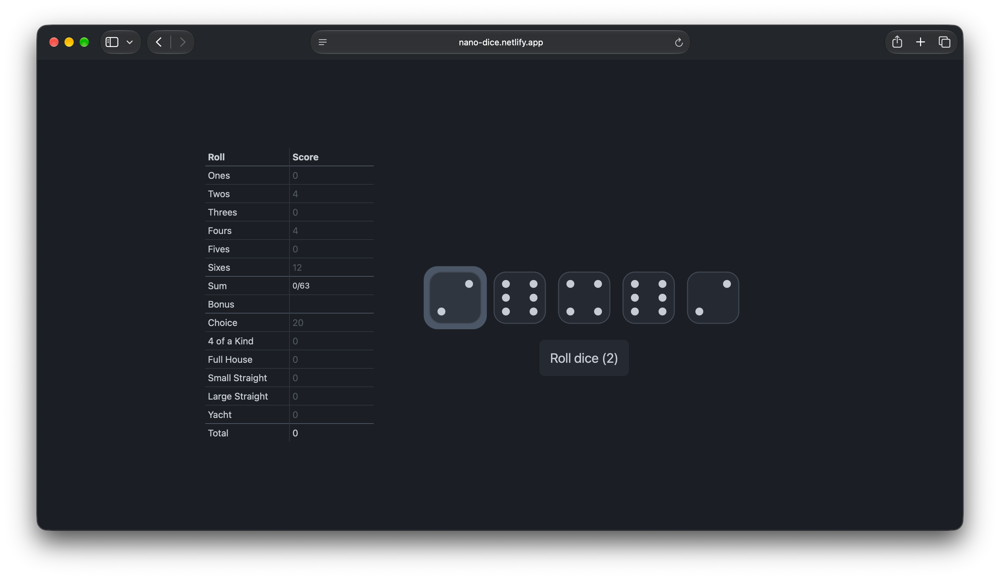

# nano-dice

A fast, lightweight Yacht clone for quick, focused play.

**Play it live:** [nano-dice.netlify.app](https://nano-dice.netlify.app)

## How to play

Roll up to three times per turn, keeping or releasing dice with **Space** or a tap. Use the arrow keys to navigate; press **Enter** to roll or confirm a score. On touchscreens, tap **Roll Dice** to roll or start the next round, and tap an available score row to choose it. Each row can be scored once.

## Scoring notes

These are the special scoring values used in nano-dice:

* **4 of a Kind:** score the sum of all five dice.
* **Small Straight:** 15 points.
* **Large Straight:** 30 points.

## Made for quick play

* Play with a keyboard or touchscreen.
* Enjoy quick dice animations and a clean, single-screen layout.
* The game follows your device’s light or dark appearance setting.
* No account or sign-up is needed.
